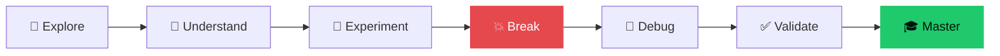
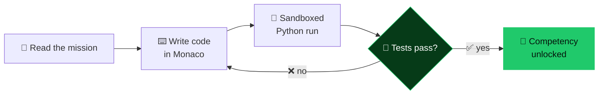
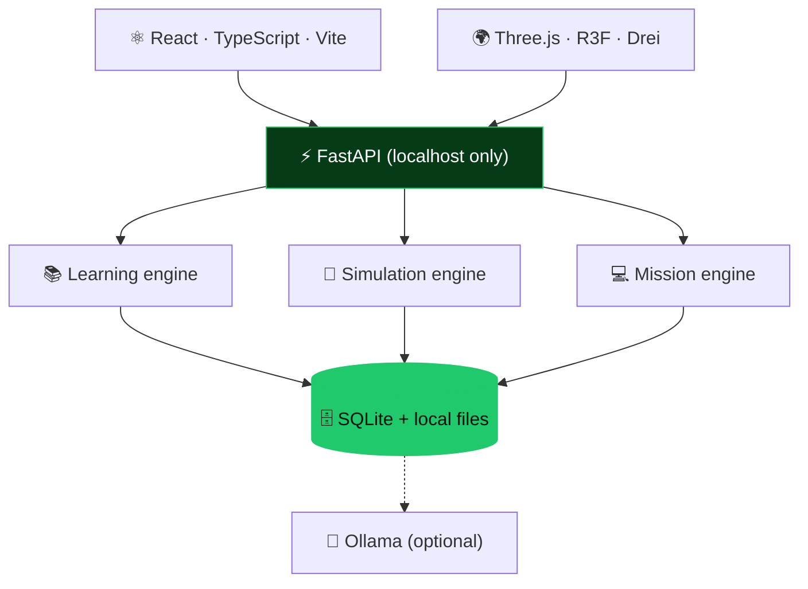

<div align="center">

```text
  ███╗   ██╗███████╗██╗  ██╗ ██████╗ ██████╗  █████╗
  ████╗  ██║██╔════╝╚██╗██╔╝██╔═══██╗██╔══██╗██╔══██╗
  ██╔██╗ ██║█████╗   ╚███╔╝ ██║   ██║██████╔╝███████║
  ██║╚██╗██║██╔══╝   ██╔██╗ ██║   ██║██╔══██╗██╔══██║
  ██║ ╚████║███████╗██╔╝ ██╗╚██████╔╝██║  ██║██║  ██║
  ╚═╝  ╚═══╝╚══════╝╚═╝  ╚═╝ ╚═════╝ ╚═╝  ╚═╝╚═╝  ╚═╝
        THE OPEN-WORLD UNIVERSITY FOR AI ENGINEERS
```

# Learn AI by breaking it.

**Walk into a 3D university. Break real neural networks. Fix them. All on your own laptop.**

`v0.1.0` · `MIT` · `100% offline` · `no account` · `no API keys` · `no GPU` · `PRs welcome`

**[⚡ Quickstart](#-run-it-in-60-seconds)** · **[🎮 Play the Daily Debug](#-play-the-daily-debug-right-here)** · **[🧪 Labs](#-six-labs-real-math)** · **[🗺️ Roadmap](#%EF%B8%8F-roadmap)** · **[🤝 Contribute](#-build-the-university-with-us)**

</div>

---

## 🤯 What is this?

Most AI courses show you a video of gradient descent.

**NEXORA hands you the learning rate and lets you blow it up.**

You start at the university gate, show your student ID, and walk across a 3D campus into real laboratories. Every experiment actually computes. Every mission runs your code against real tests. You don't level up by clicking "Next". You level up by **making a broken model converge.**

<table>
<tr>
<td width="33%" align="center">

### 🏛️ Explore
A walkable 3D campus with districts, buildings, classmates, a day/night cycle, and eight AI professors.

</td>
<td width="33%" align="center">

### 💥 Break
Six interactive labs backed by NumPy and scikit-learn. Push a parameter too far and watch the lab fail in front of you.

</td>
<td width="33%" align="center">

### 🛠️ Engineer
Five coding missions with a Monaco editor, sandboxed Python, and automated tests. Competency is earned with evidence.

</td>
</tr>
</table>



---

## ⚡ Run it in 60 seconds

```bash
git clone https://github.com/singhdeepesh20/nexora.git && cd nexora
npx pnpm@9.15.9 install
(cd backend && uv sync)
bash scripts/start.sh
```

Open **http://127.0.0.1:8765** and walk through the gate. 🎓

> **Needs:** Node.js 22+ · Python 3.12 · [uv](https://docs.astral.sh/uv/) · pnpm 9.15.9
> **Doesn't need:** a GPU, an account, or internet (after setup).

<details>
<summary><b>Developer mode (hot reload)</b></summary>

```bash
bash scripts/dev.sh
```

| Service     | Address                 |
| ----------- | ----------------------- |
| Frontend    | http://127.0.0.1:5173   |
| Backend API | http://127.0.0.1:8765   |

</details>

---

## 🎮 Play the Daily Debug right here

**Every day, a new neural network ships broken. You get six attempts to make it converge.**

Today's patient:

```python
model     = MLP(layers=[2, 16, 16, 1], activation="relu")
optimizer = SGD(lr=5.0)        # 👀
epochs    = 50

# epoch 1   loss 2.31
# epoch 4   loss 9.87
# epoch 7   loss nan   ← 💀 something is very wrong
```

**What would you change?** Click to try.

<details>
<summary>🟥 <b>Attempt 1:</b> keep <code>lr = 5.0</code> and train longer</summary>

```text
loss
 NaN ┤                        ╭── 💥
     │                 ╭╮   ╭─╯
     │          ╭╮   ╭─╯╰───╯
     │    ╭╮  ╭─╯╰───╯
 2.3 ┼────╯╰──╯
     └─────────────────────────────▶ epochs
```

**Diverged.** More epochs just means more explosion. The steps are way too big.

<details>
<summary>🟨 <b>Attempt 2:</b> drop it hard to <code>lr = 0.001</code></summary>

```text
loss
 2.3 ┼─────────╮
     │         ╰──────────╮
     │                    ╰─────── 2.05
     │
 0.0 ┤
     └─────────────────────────────▶ epochs
```

**Too slow.** It's learning, barely. After 50 epochs it's still stuck near where it started.

<details>
<summary>🟩 <b>Attempt 3:</b> try <code>lr = 0.1</code></summary>

```text
loss
 2.3 ┼╮
     │╰╮
     │ ╰──╮
     │    ╰───╮
 0.0 ┤        ╰─────────────────── 0.04 ✓
     └─────────────────────────────▶ epochs
```

**Converged!** 🎉 Now copy your result and post it:

```text
NEXORA Daily Debug #1  🧠
🟥🟨🟩  fixed in 3/6
can you beat me?
```

</details>
</details>
</details>

In the real app the network **actually trains in your browser** and the loss curve is live. Play locally at **http://127.0.0.1:8765/play.html**. A public online version is coming ([docs/VIRAL.md](docs/VIRAL.md)).

---

## 🧪 Six labs. Real math.

Here's what a single number does. Same model, same data, same starting point (`w = 3`, `loss = w²`). Only the learning rate changes.

<table>
<tr>
<th>✅ <code>lr = 0.1</code>: converges</th>
<th>💥 <code>lr = 1.2</code>: diverges</th>
</tr>
<tr>
<td>
<pre>
step      w      loss
   0    +3.00     9.00  █████████
   1    +2.40     5.76  ██████
   2    +1.92     3.69  ████
   3    +1.54     2.36  ██
   5    +0.98     0.97  █
  10    +0.32     0.10  ▏
  20    +0.03     0.00  ✓
</pre>
</td>
<td>
<pre>
step      w      loss
   0    +3.00     9.00  █████████
   1    -4.20    17.64  ██████████████████
   2    +5.88    34.57  ████████████████████▶
   3    -8.23    67.77  ████████████████████▶
   5   -16.13   260.33  ████████████████████▶
   7   -31.62  1000.08  💥
  12      nan      nan  💀
</pre>
</td>
</tr>
</table>

<p align="center"><i>That's the whole lesson, and NEXORA lets you feel it by turning the dial yourself.</i></p>

| Lab | What you get to break |
| --- | --- |
| 📉 **Gradient Descent** | Learning rates, objective functions, convergence vs. divergence |
| 🧠 **Neural Network** | Layers, weights, activations, optimizers, forward and backprop |
| 📈 **Machine Learning** | Preprocessing, classifiers, confusion matrices, precision/recall/F1 |
| 🔎 **RAG Retrieval** | Chunking, retrieval, ranking, retrieval quality |
| ✨ **Transformer** | Tokens, embeddings, positional info, attention |
| 🖥️ **AI Infrastructure** | GPU memory, batch size, quantization, inference, CPU benchmarks |

> Simulations compute real results. Simplified teaching models are labeled as simplified, and estimates are always kept separate from real hardware measurements.

---

## 🧑‍🔬 Your professors never sleep

Eight specialist professor personas, each one knows the built-in curriculum and your progress.

| | | | |
|:-:|:-:|:-:|:-:|
| **Atlas**<br>Mathematics | **Newton**<br>Machine Learning | **Neural**<br>Deep Learning | **Turing**<br>Computer Science |
| **Nova**<br>Generative AI | **Orion**<br>System Architecture | **Ada**<br>Software Engineering | **Tesla**<br>Robotics |

```text
you    › why did my loss turn into nan?
Neural › Your learning rate is 5.0. Each step overshoots the minimum
         and lands further away than it started. Try 0.1 and watch
         the curve in the Gradient Descent Lab.
```

They answer **with zero AI installed**. Want richer conversations? Plug in your own local model:

```bash
ollama pull llama3.2
```

Then pick it under **Settings → Local AI Mentor**. NEXORA never downloads models for you and never calls a paid API.

---

## 💻 Missions, not quizzes



| Mission | You prove you can… |
| --- | --- |
| 🐍 Python Fundamentals | write working Python |
| 📊 Dataset Explorer | explore and analyze real data |
| 🎯 Build a Classifier | train and evaluate a model |
| 🧠 Train a Neural Network | build one from the ground up |
| 🔎 Build a RAG Retriever | ship a retrieval pipeline |

```text
$ nexora mission run build-a-classifier
  ✓ loads dataset
  ✓ splits train/test without leakage
  ✓ accuracy ≥ 0.85            (got 0.91)
  ✗ reports precision & recall
  ─────────────────────────────
  3/4 passed · fix and resubmit
```

**Green tests or it didn't happen.**

---

## 🆚 Why NEXORA?

| | Video courses | Jupyter tutorials | **NEXORA** |
| --- | :-: | :-: | :-: |
| You change the parameters | ❌ | ✅ | ✅ |
| You see failure happen live | ❌ | 😐 | ✅ |
| Your code is graded by real tests | ❌ | ❌ | ✅ |
| It feels like a game | ❌ | ❌ | ✅ |
| Works fully offline | 😐 | ✅ | ✅ |
| No account, no tracking | ❌ | ✅ | ✅ |

---

## 🔐 Your laptop. Your data. Period.

- 🗄️ Everything lives in a **local SQLite database** and local folders
- 🚫 **No telemetry**, no cloud database, no registration
- 💾 Backup, verified restore, and full one-click deletion
- 🔄 Updates keep your data, and migrations make a safety copy first

<details>
<summary><b>Where is my data stored?</b></summary>

| OS | Location |
| --- | --- |
| macOS | `~/Library/Application Support/NEXORA` |
| Windows | `%LOCALAPPDATA%\NEXORA` |
| Linux | `~/.local/share/NEXORA` |

Override it with `NEXORA_DATA_DIR=/your/custom/path`. Uninstalling never deletes your data. See [docs/BACKUP_FORMAT.md](docs/BACKUP_FORMAT.md).

</details>

---

## 🎮 Controls

<details>
<summary><b>Show all keybindings</b></summary>

| Key | Action | Key | Action |
| --- | --- | --- | --- |
| `W A S D` | Walk | `K` | Missions |
| `Shift` | Run | `B` | Break Challenges |
| Mouse | Look | `P` | Progress |
| Scroll | Zoom | `I` | Student ID |
| `E` | Interact | `O` | University portal |
| `M` | Campus map | `L` | Personal AI lab |
| `J` | Dashboard | `Esc` | Back / Pause |

</details>

---

## 🏗️ Under the hood



| Layer | Tech |
| --- | --- |
| Frontend | React · TypeScript · Vite · Tailwind CSS · Zustand |
| 3D | Three.js · React Three Fiber · Drei |
| Backend | Python · FastAPI · Pydantic · SQLAlchemy |
| Data | SQLite (no database server) |
| Science | NumPy · scikit-learn |
| Editor | Monaco |
| Local AI | Ollama (optional) |
| Desktop | Tauri 2 (coming) |

Deep dive: [ARCHITECTURE.md](ARCHITECTURE.md).

---

## 🗺️ Roadmap

**v0.1.0 is playable today.** Three districts are open and five more are being built.

```text
CAMPUS MAP                                         v0.1.0
┌────────────────────┬────────────────────┬────────────────────┐
│ 01 FOUNDATION CITY │ 02 MACHINE LEARNING│ 03 DEEP LEARNING   │
│ python · math      │ algorithms · eval  │ nets · optimizers  │
│        ● OPEN      │        ● OPEN      │        ● OPEN      │
├────────────────────┼────────────────────┼────────────────────┤
│ 04 GENERATIVE AI   │ 05 AI ENGINEERING  │ 06 AI INFRA        │
│ LLMs · RAG · agents│ backend · systems  │ GPU · MLOps        │
│        ○ SOON      │        ○ SOON      │        ○ SOON      │
├────────────────────┴─────────┬──────────┴────────────────────┤
│ 07 ROBOTICS WORLD   ○ SOON   │ 08 INNOVATION CITY  ○ SOON    │
└──────────────────────────────┴───────────────────────────────┘
```

- [x] Playable campus, profiles, persistence
- [x] Learning and competency engine (12 concepts)
- [x] Six scientific labs
- [x] Missions and sandboxed code execution
- [x] Local AI professors
- [x] Achievements, XP, ranks, streaks, share cards, Daily Debug
- [x] University gate, student ID, portal, classmates, day/night
- [ ] 🔄 Lectures, library, hostels, cafeteria
- [ ] Tauri desktop app and installers
- [ ] Security and performance hardening
- [ ] Cross-platform release

Full detail: [IMPLEMENTATION_STATUS.md](IMPLEMENTATION_STATUS.md)

---

## 🤝 Build the university with us

NEXORA is MIT-licensed and wide open. Pick a building:

| If you're a… | You could… |
| --- | --- |
| 🎨 3D / game dev | build a new campus district |
| 🧮 ML engineer | add a lab or a Break Challenge |
| 📚 Educator | improve the curriculum or professor knowledge |
| 🐍 Python dev | design a new mission with tests |
| ⚡ Perf nerd | squeeze more FPS out of the campus |
| ♿ Accessibility advocate | make it playable for everyone |

👉 Start with [CONTRIBUTING.md](CONTRIBUTING.md), then look for issues labeled [`good first issue`](https://github.com/singhdeepesh20/nexora/labels/good%20first%20issue).

**Docs:** [Development](DEVELOPMENT.md) · [Architecture](ARCHITECTURE.md) · [Testing](TESTING.md) · [Security](SECURITY.md) · [Learning Model](docs/LEARNING_MODEL.md) · [Engagement](docs/ENGAGEMENT.md) · [Campus](docs/CAMPUS.md) · [Changelog](CHANGELOG.md)

---

<div align="center">

## ⭐ If NEXORA taught you something, star it.

It's the single fastest way to help other future AI engineers find it.

```text
╭──────────────────────────────────────╮
│   ★   YOUR FIRST DAY STARTS NOW.     │
│                                      │
│   explore → break → fix → engineer   │
╰──────────────────────────────────────╯
```

<sub>MIT License · See <a href="LICENSE">LICENSE</a> and <a href="THIRD_PARTY_NOTICES.md">THIRD_PARTY_NOTICES.md</a></sub>

</div> 


